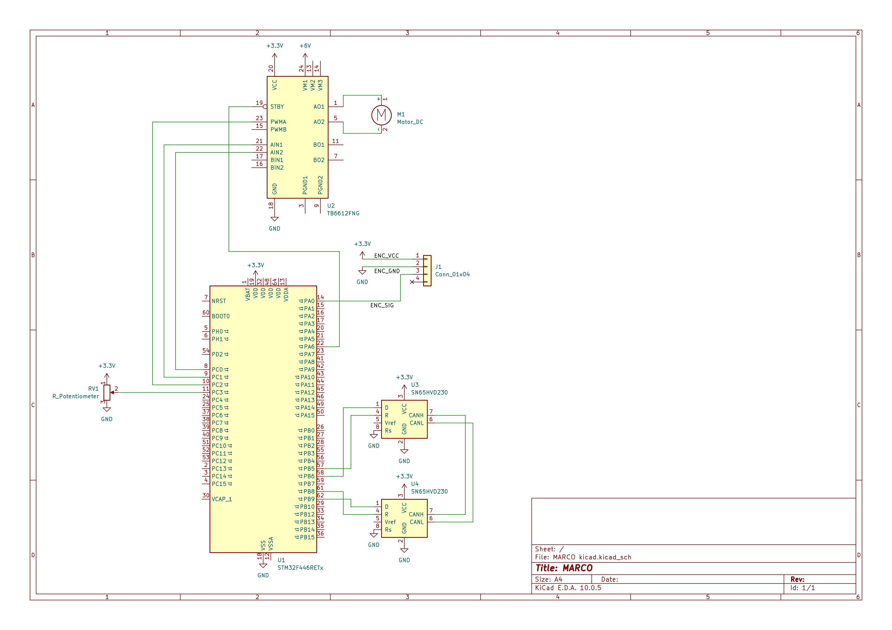

# MARCO

Motor And Realtime Control Over CAN

가변저항으로 모터를 제어하고 그 명령을 CAN으로 주고받는 소형 ECU 시스템이다.
STM32F446RE의 두 CAN 컨트롤러를 각각 다른 버스에 붙여 게이트웨이를 만들고,
HAL과 베어메탈의 성능 차이를 사이클 단위로 측정했다.

---

## 데이터 흐름

```
가변저항 → ADC(PC3) → CAN1이 MotorCommand 프레임 생성
   → 트랜시버1 → CAN 버스 → 트랜시버2
   → CAN2 수신·파싱 → TB6612FNG → 모터

엔코더(PA0) → TIM2 펄스 카운트 → CAN2가 MotorStatus 프레임 생성
   → 버스 → CAN1 수신 (상태 모니터링)
```

명령과 피드백이 반대 방향으로 흐르며 둘 다 실제 버스를 경유한다.
로컬에서 바로 처리하지 않은 것은 센서 ECU와 액추에이터 ECU가 분리된
실제 차량 구조를 재현하기 위해서다.

---

## 하드웨어 구성



*클릭하면 원본 크기로 볼 수 있다.*

---

## 측정 결과

DWT 사이클 카운터, Release 빌드, 84MHz 기준이다.

| 비교 항목 | HAL / 기존 | 베어메탈 / 개선 | 차이 |
|---|---|---|---|
| GPIO 제어 (함수 기반 HAL) | 48 cycles | 14 cycles | 3.4배 |
| PWM 듀티 설정 (매크로 기반 HAL) | 4 cycles | 5 cycles | 차이 없음 |
| 듀티 변환 (나눗셈 → Q16 양자화) | 15 cycles | 9 cycles | 1.67배, 최대 오차 ±1 |
| ADC 이동평균 필터 | 62 cycles | 83 cycles | 노이즈 표준편차 1.139 → 0.5 |

PWM에 차이가 없는 것은 `__HAL_TIM_SET_COMPARE()`가 매크로라 베어메탈과 같은 코드로
치환되기 때문이다. GPIO 오버헤드는 HAL 소스를 열어본 결과 `assert_param`이 아니라
함수 호출과 조건 분기가 원인이었다.

---

## CAN 메시지 설계

[`others/MARCO.dbc`](others/MARCO.dbc)에 정의했고 cantools와 CANdb++로 검증했다.

| 대역 | 버스 | 메시지 |
|---|---|---|
| 0x100 ~ 0x1FF | 제어 | EmergencyStop, MotorCommand, ControlHeartbeat |
| 0x200 ~ 0x2FF | 모니터링 | MotorStatus, PotValue, EncoderCount, DiagStatus, MonitorHeartbeat |

CAN 컨트롤러는 자기 송신을 스스로 다시 수신하므로, 조건 없이 반대편으로 전달하면
두 버스 사이를 무한히 순환한다. 실제로 겪었고 ID 대역으로 출처를 판별해 해결했다.
`EmergencyStop`의 ID가 가장 낮은 것은 아비트레이션 우선권 때문이다.

---

## 개발 환경

| 구분 | 내용 |
|---|---|
| 보드 | Nucleo-F446RE (Cortex-M4, 84MHz) |
| 툴체인 | arm-none-eabi-gcc (gnu-tools-for-stm32) |
| 빌드 | CMake + Ninja, STM32CubeMX 생성 코드 기반 |
| 편집기 | VSCode |
| 업로드 | STM32CubeProgrammer (ST-LINK) |
| 계측 | 로직분석기(PulseView), 멀티미터, DWT 사이클 카운터 |
| CAN 도구 | cantools, Vector CANdb++ Editor |
| 회로도 | KiCad 10 |

주변 회로는 TB6612FNG, SN65HVD230 2개, 엔코더 내장 DC 모터, 가변저항으로 구성했다.

---

## 저장소 구성

```
Inc/         헤더 파일
Src/         소스 코드
others/      DBC 파일, 회로도 등
보고서/       단계별 결과 보고서, 트러블슈팅 로그
```

---

## 진행 단계

| 단계 | 내용 | 상태 |
|---|---|---|
| Phase 0 | 개발 환경 구축 | 완료 |
| Phase 1 | GPIO / PWM / ADC / CAN 베어메탈 전환, 엔코더 + PID 폐루프 | 완료 |
| Phase 2 | HAL vs 베어메탈, 나눗셈 vs 양자화, 원시값 vs 필터 성능 측정 | 완료 |
| Phase 3 | CAN1↔CAN2 게이트웨이, DBC 설계, ID 대역 라우팅 | 완료 |
| Phase 3.5 | CAN 명령과 모터 제어 통합 | 완료 |
| Phase 4 | FreeRTOS 이식 | 예정 |
| Phase 5~7 | 라즈베리파이 + SocketCAN 노드 결합, 리눅스 드라이버 | 예정 |

실측 데이터와 트러블슈팅 기록은 `보고서/` 폴더에 있다.

---

## 현재 한계

브레드보드 프로토타입이라 전원 레일 접촉 불량, 모터와 엔코더의 GND 공유로 인한
전압 강하를 겪었다. 원인은 좁혔으나 완전히 제거하지 못했고 그 범위 안에서 검증했다.

엔코더가 1채널 펄스 방식이라 신호만으로 회전 방향을 알 수 없지만,
방향은 구동 명령으로 이미 알고 있어 속도 제어에 지장은 없다.

게이트웨이는 보드 한 장의 CAN1/CAN2로 구성했다. 분리된 두 버스에 별도 노드를 붙이는
구성과 다중 노드 아비트레이션 실측은 Phase 5로 미뤘다.
